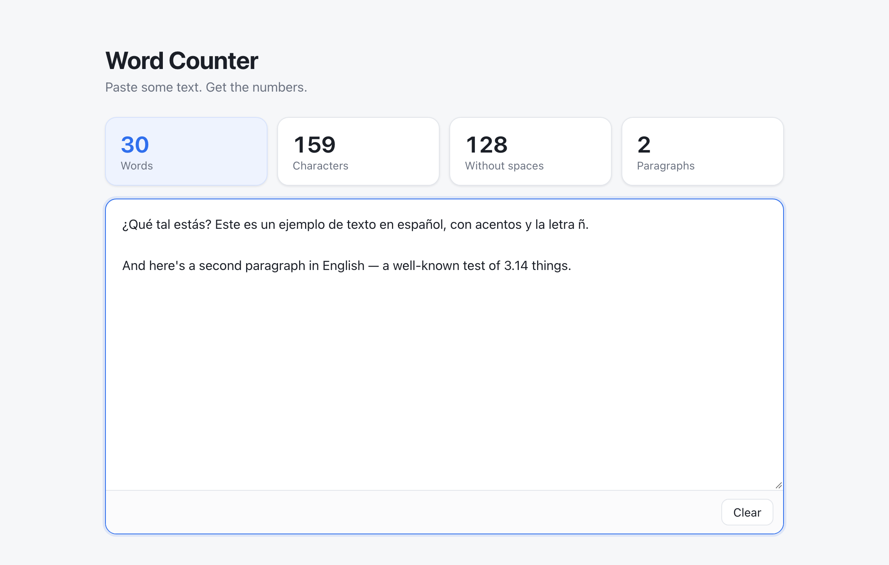

# char-slash-word-counter

Paste a chunk of text, get the word and character count. Works with Spanish, English and any other language that puts spaces between words.



## Run it

```bash
python3 -m venv .venv && source .venv/bin/activate
pip install -r requirements.txt
python3 app.py
```

Open http://localhost:8000. Set `PORT` to use a different port.

## How it counts

| Stat | Rule |
| --- | --- |
| Words | Runs of letters or digits. `don't`, `well-known` and `3.14` are one word each. Punctuation like `¿ ¡ — ...` is ignored. |
| Characters | Everything, including spaces and line breaks. `é` is always one character. |
| Without spaces | Same as above, minus any whitespace. |
| Paragraphs | Blocks of text separated by a blank line. |

There's also a small JSON API:

```bash
curl -X POST localhost:8000/api/count \
  -H 'Content-Type: application/json' \
  -d '{"text": "¿Qué tal? Muy bien."}'
# {"characters":19,"characters_no_spaces":16,"paragraphs":1,"words":4}
```

## Tests

```bash
python3 -m unittest
```

## Roadmap

- [ ] Upload PDF and DOCX files
- [ ] LaTeX: count only what shows up in the rendered document, not commands or comments

## License

[MIT](LICENSE)
